# Telco Customer Churn Prediction: An Early-Warning System for Customer Retention

Which customers of a telecom provider are about to leave, why, and who should the retention team call first? This
project answers those questions with the **IBM Telco Customer Churn** sample: **7,043 customers** of a fictional
California provider, of whom **one in four left in a single quarter**. It builds a **Gradient Boosting** model that
flags customers at risk early enough to make them an offer.

The analysis lives in [`notebooks/01_churn_analysis_and_modelling.ipynb`](notebooks/01_churn_analysis_and_modelling.ipynb).
This README retells the notebook in plain language, section by section, without any code. The model is retrained as a
tracked MLflow run, served behind a monitored API, and used by a Streamlit early-warning app for the retention team of
the fictional carrier **MurphysTelecom** in [`app/`](app/).

[](https://murphys-telecom-churn-system.streamlit.app/)

**Try the app:** open the live demo at
[murphys-telecom-churn-system.streamlit.app](https://murphys-telecom-churn-system.streamlit.app/), or run it on your
own computer in two commands (see [How to Run](#how-to-run)). The live demo can take a few seconds to wake up after a
quiet period.

## At a glance

| Question | Answer |
|---|---|
| How many customers leave? | **26.5%** in one quarter (1,869 of 7,043), about ten times the level of large U.S. carriers. The data is a synthetic stress scenario. |
| Who leaves most? | Customers on a **month-to-month contract** (45.8% left, against 2.6% on two-year contracts), in their **first months** (median 10 months as a customer, against 38 for those who stay), and on **fiber internet without security or support add-ons**. |
| Why do they say they left? | Mostly because of a **competitor** (45.0% of leavers), most often for better devices. These reasons are recorded only after leaving, so the model never sees them. |
| How good is the early warning? | It catches **89% of the customers who leave** while calling **40%** of all customers. Calling every month-to-month customer would catch 92% but needs 52% of customers, with fewer correct calls (precision 0.59 against 0.47). |
| Is it worth it? | Under illustrative campaign costs, the model's call list is worth **341,307** against 317,765 for the simple rule (+7.4%). A pilot with a control group is still needed to prove real retention. |
| What should the business do first? | Offer **longer contracts** to month-to-month customers, check in during the **first months**, bundle **security and support add-ons** for fiber customers, and **review Offer E**, whose takers leave at 52.9%. |

### How the notebook is organised

The work follows **CRISP-DM**, a standard step-by-step method for data projects: understand the problem, understand
the data, prepare it, build models, evaluate them, and put them to use.

| # | Section | What it covers |
|---|---|---|
| 1 | [Project Overview](#1-project-overview) | Why churn matters and how high it is here |
| 2 | [Business Understanding](#2-business-understanding) | Problems, goals, people involved, and how success is measured |
| 3 | [Setup](#3-setup) | The tools used |
| 4 | [Data Understanding](#4-data-understanding) | Where the data comes from, how clean it is, and what it shows |
| 5 | [Data Preparation](#5-data-preparation) | Turning the data into something a model can learn from, without cheating |
| 6 | [Modelling](#6-modelling) | Building and choosing the model, and turning scores into a call decision |
| 7 | [Evaluation](#7-evaluation) | How well the model works on customers it has never seen |
| 8 | [Deployment](#8-deployment) | The tracked training run, the served model, monitoring, and the app |
| 9 | [Conclusion and Recommendations](#9-conclusion-and-recommendations) | What it all means and what to do about it |

To run the app, the tests, the training or the serving stack yourself, see [How to Run](#how-to-run).

The notebook departs from the textbook order of CRISP-DM in two places, on purpose:

* **Modelling is prototyped in the notebook, then repeated as a tracked run.** Sections 6–7 train and evaluate the
  model in memory; the final, reproducible training with experiment tracking runs in `pipelines/train.py`
  (Section 8).
* **The training and test split is fixed during Data Preparation (Section 5).** This way, every preparation step
  learns from the training customers only.

---

## 1. Project Overview

**A customer who has already decided to leave is expensive to win back. Retention works best when the risk is
visible before the cancellation request.**

**Churn is costly.** *Customer churn* is the loss of customers who stop using a company's services. For a
subscription business such as telecommunications, every lost customer means lost recurring revenue plus the cost of
finding a replacement. Estimates of how much more it costs to win a new customer than to keep an existing one range
from **5 to 25 times**, depending on the study and the industry.

**Churn in this case study is extreme.**

* In Q3 2025 the three largest U.S. carriers reported phone churn between **0.89% and 0.92% per month**, and Verizon
  reported **0.94%** for Q3 2026. That is roughly 2.6–2.7% of customers per quarter.
* The fictional company in this dataset lost **26.5% of its customers in a single quarter**, about ten times that
  level.
* The figures are not directly comparable: the data is synthetic, it covers home phone and internet customers, and
  half of them (51.3%) are on month-to-month contracts. The dataset is best read as a **high-churn stress scenario**,
  where an early-warning model has the most room to add value.

**What drives churn?** A review of 37 telecom studies names age, gender, satisfaction, switching costs and service
quality as the most frequently reported drivers. A 2025 survey of 56,450 U.S. wireless customers finds that value is
the most important part of the experience, closely followed by service quality. The dataset tells a consistent story:
among the 1,869 customers who left, **"Competitor" is the most common category (841 customers, 45.0%)**, and the
single most frequent reason is **"Competitor had better devices" (313 customers, 16.7%)**.

**Why predicting churn alone is not enough.** The customers most likely to leave are not always the ones an offer can
save. Field experiments show that targeting purely on churn risk can waste retention budgets, and that campaigns should
aim at customers whose behaviour the offer actually changes. The model is therefore judged on the value of the
retention campaign, not only on statistical accuracy.

**What this project delivers.** For the retention team, it answers three practical questions:

1. Who leaves, and how many?
2. Which characteristics go with leaving?
3. Which individual customers should be contacted, before they cancel?

All sources are listed under [References](#references).

---

## 2. Business Understanding

**Retention starts too late when a cancellation request is the first warning.** By then the customer has usually
compared alternatives, and the most common reason for leaving is a competitor's offer. An early warning gives the
retention team time to act while the customer is still open to an offer.

### 2.1 Problem Statements

1. **No consolidated picture of who leaves and how many.** Churn is visible only as a total, so it is unclear which
   customer groups carry the highest risk.
   *At stake:* retention budgets are spread evenly instead of being focused on high-risk groups.
2. **The characteristics behind churn are not measured.** It is unclear which contract, service, billing and
   household characteristics move most closely with leaving.
   *At stake:* retention offers stay generic instead of addressing why customers leave.
3. **No early warning for individual customers.** The company learns about churn when the customer cancels.
   *At stake:* retention becomes damage control, and revenue from customers who could have been saved is lost.

### 2.2 Goals

Each goal answers one problem. The codes in brackets refer to the success criteria in Section 2.4.

1. **Set a churn baseline and a risk profile per customer group** [B1, D1]. Measure the overall churn rate, the
   balance between leavers and stayers, and the churn rate of every customer group (household, location, products,
   contract and billing).
2. **Find the characteristics most closely linked to churn** [B2, D2]. Rank categorical characteristics with a
   statistical test on the training customers, compare numerical characteristics of leavers and stayers, and confirm
   the ranking with the model.
3. **Build an early-warning model that never sees the outcome** [B3, D3–D5]. Train a Gradient Boosting model that
   flags customers at risk, beats a simple business rule, and is served to the retention team through an app.

### 2.3 Situation Assessment

**Who uses the results, and for what.** The company is fictional, so this map is a proposal based on how churn
programmes are usually organised.

| Stakeholder | Decision supported | What they use |
|---|---|---|
| Retention / CRM team (**main user**) | Which customers to contact, and with which message | Ranked list of at-risk customers with their main reasons (app) |
| Marketing and offer management | Which retention offers to design, e.g. longer contracts | Churn rates per group, ranking of drivers, campaign results against a control group |
| Customer care | How to handle contacts from at-risk customers | Risk flag visible during the contact |
| Finance | How much retention budget to approve | Expected campaign value at a given call volume |
| Network and product teams | Which product or service issues to fix first | Churn rates per product and internet type |
| Data science / MLOps | When to retrain or roll back the model | Reproducible preparation, tracked runs, live performance feedback |

**Resources**

* **Data:** one IBM sample file with 7,043 customers and 50 columns, describing a single quarter as a snapshot.
* **Tools:** Python (pandas, scikit-learn), Optuna for tuning, MLflow with DagsHub for experiment tracking, a
  Prometheus exporter for monitoring, and Streamlit for the app.

**Requirements, assumptions and constraints**

* The model may only use information known **before** a customer leaves.
* The data is synthetic and has no dates per customer, so a time-based test is not possible; a stratified random split
  is used instead.
* No real retention costs are available, so campaign value uses illustrative cost ratios from the literature.

**Risks and how the notebook handles them**

| Risk | How it is handled |
|---|---|
| The model "sees the outcome" and looks better than it is (data leakage) | Columns that describe the churn itself are removed, and every learned step uses the training customers only |
| Only 26.5% leave, so a model is tempted to predict "stays" | Stratified split, balancing of the training customers, and recall and precision instead of accuracy |
| Test results are too optimistic | Model choice and cut-offs on cross-validation; the test customers are used once |
| Probabilities are distorted by the balancing | Probabilities are corrected to the real churn rate before a cut-off is chosen |

### 2.4 Success Criteria and Evaluation Metrics

Success is judged in two ways: does the project help the **people** who use it (business criteria), and are the
**analytical results** good enough (data-mining criteria)? Both are fixed before modelling and checked in Section 7.8.

**A useful model must beat what the business could do without it.** The data suggests a simple rule: **call every
month-to-month customer**. Month-to-month customers make up 88.6% of leavers and leave at 45.8%, so this rule already
catches most leavers. The model is measured against this rule, not just against random calling.

**Business success criteria**

| ID | Objective | Success means |
|---|---|---|
| B1 | A consolidated view of churn | The overall churn rate and the rate of every customer group are reported and traceable to the data |
| B2 | Targeted retention | The characteristics most linked to churn are ranked and turned into retention levers, each with an owner |
| B3 | Proactive retention | The expected campaign value is positive at the chosen cut-off, and a pilot shows lower churn among contacted customers than in a random control group |

**Data-mining success criteria** (measured on the test customers, who keep the real 26.5% churn rate)

| ID | Goal | Criterion | Target |
|---|---|---|---|
| D1 | 1 | Churn baseline | Churn rate, class balance and churn rate per category reported |
| D2 | 2 | Ranking of drivers | Statistical screening on the training customers, group comparisons, and model feature importance |
| D3 | 3 | Catch most leavers | Recall of **0.85 or more** on the test customers |
| D4 | 3 | Beat the month-to-month rule | Precision **and** F1 above the rule on the same test customers |
| D5 | 3 | Validity | No outcome columns, every learned step on the training customers, test customers used once |

**How performance is measured**

* **Recall:** of all customers who leave, the share the model flags. A missed leaver forfeits their remaining value.
* **Precision:** of all flagged customers, the share who actually leave, i.e. how many calls are not wasted.
* **F1:** a balance of precision and recall.
* **PR-AUC and lift:** views that do not depend on a cut-off. Lift = precision ÷ 26.5%: a lift of 2 means flagged
  customers leave twice as often as the average customer.
* **Campaign net value:** customer value saved, minus offer and contact costs, for the customers the model flags.

**Illustrative campaign economics.** The company publishes no retention costs, so these are assumptions, scaled from
the default values of a standard profit measure for churn models to the median customer value of leavers (≈ 4,250):

| Parameter | Ratio to customer value | Illustrative value |
|---|---|---|
| Customer value saved | — | ≈ 4,250 |
| Retention offer cost | 5% | ≈ 212.5 |
| Contact cost | 0.5% | ≈ 21.25 |
| Share of contacted leavers who accept and stay | — | 30% |

Under these assumptions, **calling a customer pays off once their chance of leaving exceeds about 16%** (the
*break-even cut-off*). A missed leaver costs far more than a wasted offer, which supports the high recall target.

### 2.5 Solution Approach

**A. Describing and explaining the data (Goals 1 and 2)**

* **Churn baseline:** the overall churn rate, the class balance, and the churn rate of every category of every
  customer characteristic.
* **Comparing leavers and stayers:** smoothed distributions and box plots of every numerical characteristic.
* **Links between characteristics:** a correlation matrix of numerical characteristics, and a chi-square test (does a
  category's share differ between leavers and stayers?) on the training customers.

**B. Predicting churn with machine learning (Goal 3)**

* **Leakage-safe preparation** in four phases (Section 5), so that no information from the test customers or from the
  outcome reaches the model.
* **Method:** **Gradient Boosting**, which adds small decision trees one by one, each correcting the last. It handles
  mixed data and threshold effects well and shows which inputs matter.
* **Candidates:** logistic regression and Gradient Boosting with default settings, and Gradient Boosting tuned
  automatically with **Optuna**. Candidates are compared with **5-fold stratified cross-validation** on the F2 score,
  which weights recall twice as much as precision.
* **From score to decision:** probabilities are corrected for the balancing, and two cut-offs are chosen on the
  training customers: a **recall cut-off** (criterion D3) and the **break-even cut-off** (campaign economics).
* **Delivery:** a tracked, reproducible MLflow run, a monitored serving API, and a Streamlit app (Section 8).

---

## 3. Setup

This section only prepares the working environment, so it is not part of the CRISP-DM method.

* **Tools:** Python, with **pandas** and **NumPy** for data handling, **Matplotlib** and **seaborn** for charts,
  **SciPy** for statistical tests, **scikit-learn** for preparation and modelling, **Optuna** for tuning, and
  **joblib** for saving the preparation steps.
* **Version checks:** the notebook checks that each library is recent enough and stops with a clear message if one is
  too old. Exact versions are pinned in `requirements.txt`.
* **One place for settings:** every project-wide setting is defined once, including the random seed, the test share,
  the significance level and the recall target.

---

## 4. Data Understanding

The data is a synthetic sample, so its patterns illustrate analytical relationships rather than a real market.

### 4.1 Data Source

| Dataset | One row per | Rows | Columns | What it contains |
|---|---|---|---|---|
| IBM Telco Customer Churn (11.1.3+), via Kaggle | Customer (Q3 snapshot) | 7,043 | 50 | Household, location, services, account and billing, satisfaction, churn outcome |

IBM describes a **fictional** provider of home phone and internet services to 7,043 customers in **California** in
**Q3**.

### 4.2 Data Description

The 50 columns fall into clear groups, and each has a role in this project:

| Group | Examples | Role |
|---|---|---|
| Identifier and location | Customer ID, city, zip code, coordinates, population | **Excluded:** unique or near-unique values that do not generalise to new customers |
| Household | Age, under 30, senior citizen, married, dependents | Features |
| Referrals | Referred a friend, number of referrals | Features |
| Account | Months as a customer, offer, contract, paperless billing, payment method | Features |
| Services | Phone, multiple lines, internet type, security, backup, device protection, tech support, streaming, unlimited data | Features |
| Usage and billing | Monthly charge, total charges, refunds, extra data and long-distance charges, total revenue | Features |
| Satisfaction and value | Satisfaction score; customer lifetime value (CLTV) | Satisfaction **excluded** (suspected leakage); CLTV is a feature |
| Churn outcome | **Churn Label** (the target); customer status, churn score, churn category, churn reason | Target; the others are **excluded** because they describe the outcome itself |

### 4.3 Data Quality

The data was checked for size, duplicate rows and customer IDs, missing values, and the frequency of every category.

* **Duplicates:** none.
* **Missing values appear in four columns only, and none is a data-entry error:**
  * churn category and churn reason: 5,174 rows (73.5%), exactly the customers who did **not** leave. Reasons exist
    only for leavers, so these columns describe the outcome;
  * offer: 3,877 rows (55.0%), meaning *no offer accepted*;
  * internet type: 1,526 rows (21.7%), meaning *no internet service*. A follow-up check confirms that these are
    exactly the customers without internet.

**Bottom line:** the data is clean. The gaps are meaningful categories, which are filled with an explicit "none"
label, and the outcome columns are removed.

### 4.4 Exploring the Data

The exploration answers four questions:

1. How large is churn, and how unbalanced are leavers and stayers? (Goal 1)
2. Which customer groups leave most? (Goals 1 and 2)
3. How do the numerical characteristics of leavers and stayers differ? (Goal 2)
4. Which characteristics overlap, and which could leak the outcome? (needed to design the model)

Most charts show the **churn rate**: the share of customers in a group who left during the quarter. The overall
26.5% is the benchmark.

#### How many customers leave?

* **One in four.** 26.54% of customers left and 73.46% stayed, a ratio of about 1 to 2.8.
* **Almost all leavers were on month-to-month contracts:** 88.6%, against 8.9% on one-year and 2.6% on two-year
  contracts. The pie chart shows *who the leavers were*, not how often each contract leaves; the actual rates follow
  below.

**What this means:** predicting "stays" for everyone would already be 73.5% accurate, so accuracy is the wrong
measure. The model is judged on recall, precision and F1 for leavers, and the training customers are balanced.

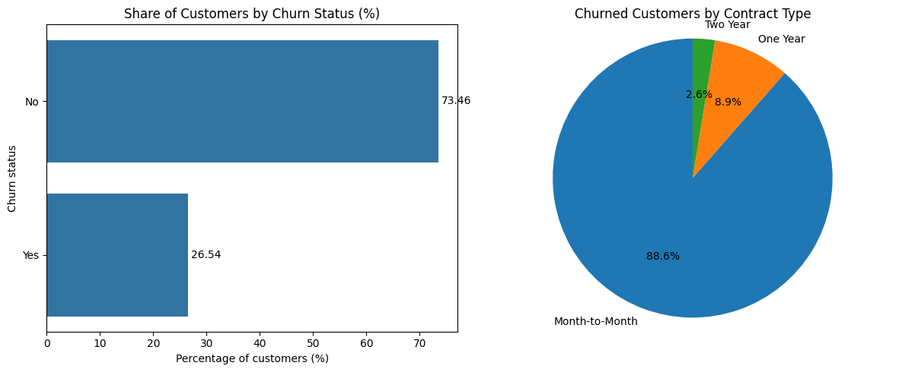

#### Household

* **Gender makes no difference:** 26.9% (female) against 26.2% (male).
* **Seniors leave more:** 41.7% of senior citizens left, against 23.6% of younger customers.
* **Customers under 30 leave less** (21.7%) than older customers (27.7%).
* **Unmarried customers leave more:** 33.0% against 19.7% for married customers.

"Under 30" and "senior citizen" are both derived from age, and marital status may work through household size or
family plans. These are links, not causes.

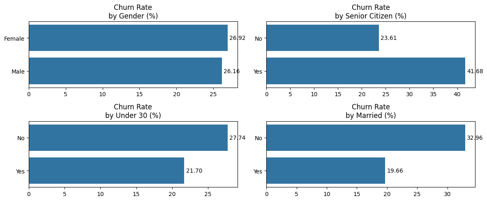

#### Location

* **San Diego has by far the most leavers (185)**, followed by Los Angeles (78), San Francisco (31) and San Jose (29).
* **Counts mostly follow city size**, and the "bottom 10" cities are an arbitrary pick among many cities tied at one
  leaver.
* **Follow-up check:** limited to cities with at least 30 customers, San Diego's churn *rate* is **64.9%** (285
  customers), far above the average. IBM deliberately built a churn cluster around San Diego into this sample.

City has too many categories with few customers each, so it is left out of the model.

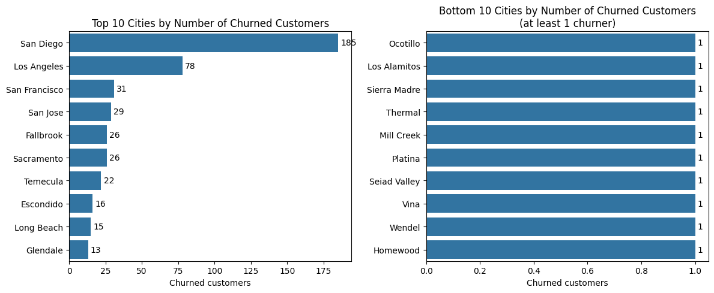

#### Products and services

* **Internet customers leave far more:** 31.8% against 7.4% for customers without internet.
* **Fiber is the riskiest connection:** fiber optic 40.7%, cable 25.7%, DSL 18.6%.
* **Protective add-ons go with staying:** online security 14.6% (with) against 31.3% (without), premium tech support
  15.2% against 31.2%, online backup 21.5% against 29.2%, device protection 22.5% against 28.7%.
* **Streaming and unlimited data seem to increase churn** (e.g. unlimited data 31.7% against 16.0%), but this is
  **confounding**: customers without internet answer "No" to every add-on and rarely leave, which pulls the "No" rate
  down. **Follow-up check:** among internet customers only, the sign flips. Streaming and unlimited data go with
  slightly *lower* churn, while online security shows the largest gap (15% against 42%).
* **Phone service makes little difference:** 26.7% against 24.9%.

**What this means:** fiber customers without security or support add-ons are a natural first group for retention
campaigns. Customers who buy add-ons may already be more engaged, so this does not prove that selling add-ons
*causes* lower churn.

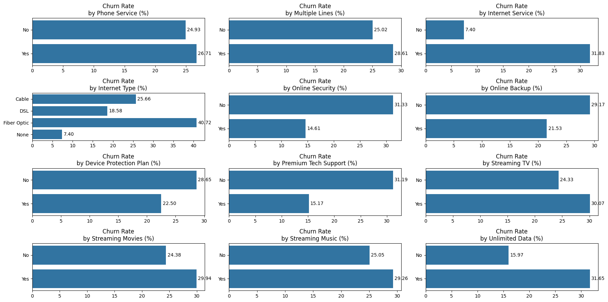

#### Contract, offer and billing

* **Contract length is the strongest signal:** month-to-month 45.8%, one year 10.7%, two years 2.6%. Month-to-month
  customers leave about **18 times** as often as two-year customers.
* **Offers:** churn rises from Offer A (6.7%) to **Offer E (52.9%)**; customers who accepted no offer leave at 27.1%.
  Offers may be aimed at already risky customers, so Offer E's rate may reflect *who received it*.
* **Paperless billing:** 33.6% (yes) against 16.3% (no).
* **Payment method:** mailed check 36.9%, bank withdrawal 34.0%, credit card 14.5%.

**What this means:** moving month-to-month customers to longer contracts is the most promising lever in the data. A
controlled test is needed to confirm the effect.

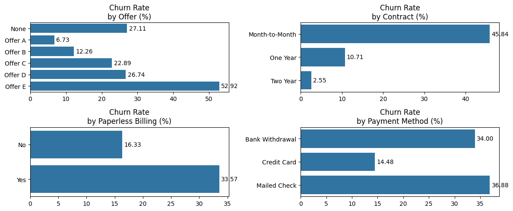

#### Numerical characteristics

Smoothed distributions (each group scaled separately) and box plots compare leavers with stayers:

* **Months as a customer:** about **10** for leavers against about **38** for stayers. Leavers cluster in their first
  months.
* **Monthly charge:** about 80 against about 65; leavers mostly pay 70–110 a month.
* **Age:** about 50 against about 45.
* **Customer value (CLTV):** slightly lower for leavers (about 4,250 against 4,600).
* **Long-distance charges:** almost identical, so little signal on their own.
* **Satisfaction score:** leavers score only 1–3 and stayers only 3–5; the groups overlap only at 3. A score that
  splits the groups almost perfectly is a **warning sign of leakage** (see Section 5.1).
* **Refunds and extra data charges are zero for most customers.** Every non-zero value looks like an outlier in a box
  plot, but these are real values. The totals have long upper tails.

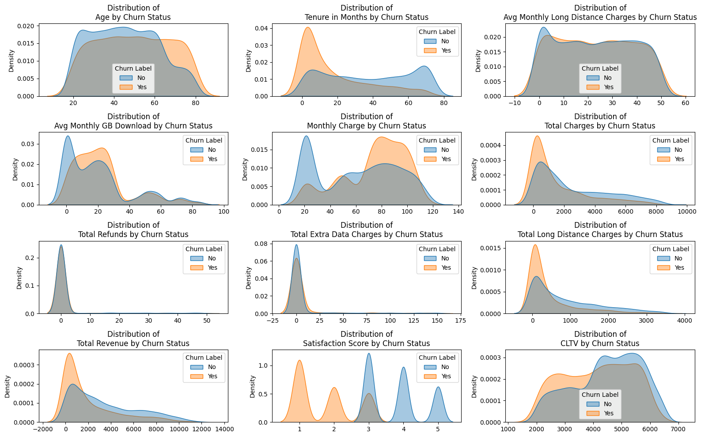

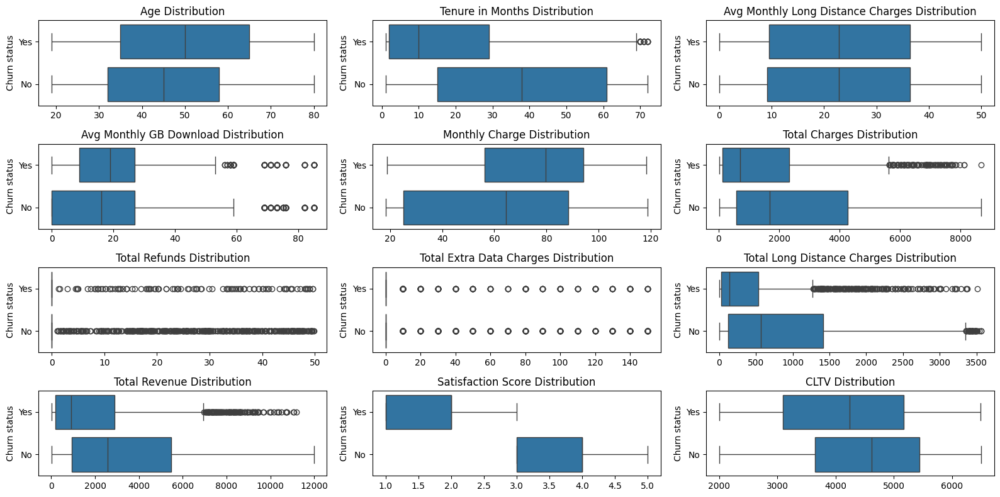

#### Which characteristics overlap?

This uses **Pearson correlation (r)**, which measures how closely two numbers move together in a straight line, from
−1 to +1. Pairs at |r| ≥ 0.6 are treated as strongly overlapping.

* **Seven pairs overlap strongly, all among billing totals and months as a customer:** total revenue and total charges
  (0.97), months and total revenue (0.85), months and total charges (0.83), total revenue and long-distance charges
  (0.78), months and long-distance charges (0.67), total charges and monthly charge (0.65), and long-distance and total
  charges (0.61).
* **These links are mechanical, not behavioural:** totals grow with every month a customer pays. A follow-up check
  confirms that total revenue equals total charges − refunds + extra data charges + long-distance charges for every
  customer.

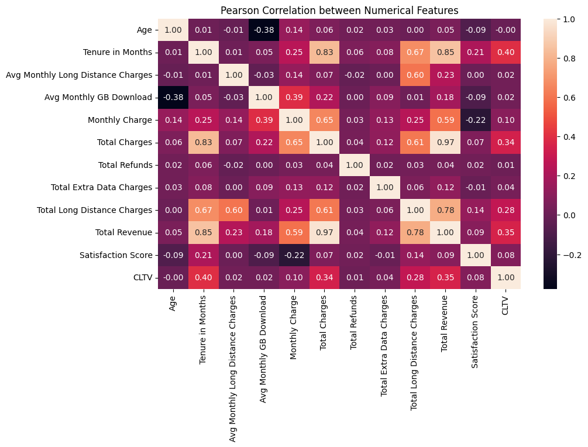

#### Summary of the exploration

1. **Baseline.** 26.5% of customers left in the quarter, about 1 in 4.
2. **Drivers.** Contract type separates risk most clearly (45.8% against 2.6%). Risk is also high in the first
   months, for fiber internet (40.7%), without online security or tech support (about 31%), for mailed-check and
   bank-withdrawal payers, for Offer E (52.9%), and for seniors (41.7%).
3. **Leakage risks.** Churn reason, category, status and score describe the outcome, and the satisfaction score splits
   the groups almost perfectly.
4. **Data properties.** Gaps are meaningful, refunds and extra data charges are mostly zero, totals have long tails,
   and five billing and tenure characteristics overlap strongly.

### 4.5 From Exploration to Preparation

| What the exploration found | What the preparation does |
|---|---|
| Missing offer and internet type mean "none" | Fill them with an explicit "none" label |
| Churn reason, category, status and score describe the outcome | Remove them |
| The satisfaction score splits the groups almost perfectly | Remove it as suspected leakage (reversible setting) |
| City counts follow city size; location has many unique values | Remove identifiers and location |
| Only 26.5% leave | Stratified split, balance the training customers, judge on recall, precision and F1 |
| Gender and phone service show similar churn rates | Test every category on the training customers and drop the unlinked ones |
| Refunds, extra data and dependents are mostly zero | Skip them when capping extreme values |
| Billing totals have long tails | Log-transform skewed characteristics |
| Five billing and tenure characteristics overlap | Compress them into two components (PCA) |

---

## 5. Data Preparation

The preparation runs in **four phases**. The guiding rule is that **every step that learns something from the data is
fitted on the training customers only** and then applied unchanged to the test customers, so the test stays a fair
simulation of new customers.

### 5.1 Phase A: Before the Split

A characteristic may only be used if its value is known **when the prediction is made**. Using information recorded
after the outcome is called *data leakage*: the model looks excellent in development and fails in practice.

* **Removed: identifiers and location** (customer ID, city, zip code, coordinates, and the single-value country, state
  and quarter).
* **Removed: the outcome itself** (customer status, churn category, churn reason) and **churn score**, which is the
  output of another churn model.
* **Removed: satisfaction score (suspected leakage).** Satisfaction does predict retention when it is measured
  *before* a customer decides. Here, three warning signs point the other way: it splits leavers and stayers almost
  perfectly, every single customer has a score (unusual for a voluntary survey), and IBM does not say when it is
  collected. It can be added back if a score recorded before the prediction becomes available.
* **Kept: referrals.** They describe actions taken while the customer is still active. In a field study at a mobile
  provider, customers who recommended the provider left at 7% within a year, against 19% in a matched control group.
* **Filled:** missing offer and internet type become "none".

**Result:** 7,043 customers with 35 candidate characteristics and the target.

### 5.2 Phase B: Stratified Split

The customers are split into **80% training (5,634)** and **20% test (1,409)**. *Stratification* keeps the 26.5%
churn rate identical in both, so the test customers are representative. A time-based split is not possible because
the snapshot has no dates per customer.

### 5.3 Phase C: Learning from the Training Customers Only

* **Statistical screening.** A chi-square test on the training customers finds no link to churn for **gender**
  (p = 0.48) and **phone service** (p = 0.36); both are dropped. With about 5,600 customers even weak links become
  significant, so the test shows *whether* a link exists, not how strong it is.
* **Capping extreme values.** Values beyond 1.5 times the interquartile range are capped for 10 characteristics.
  Refunds, extra data charges and number of dependents are skipped: they are zero for most customers, so capping would
  turn every non-zero value into zero and erase them.

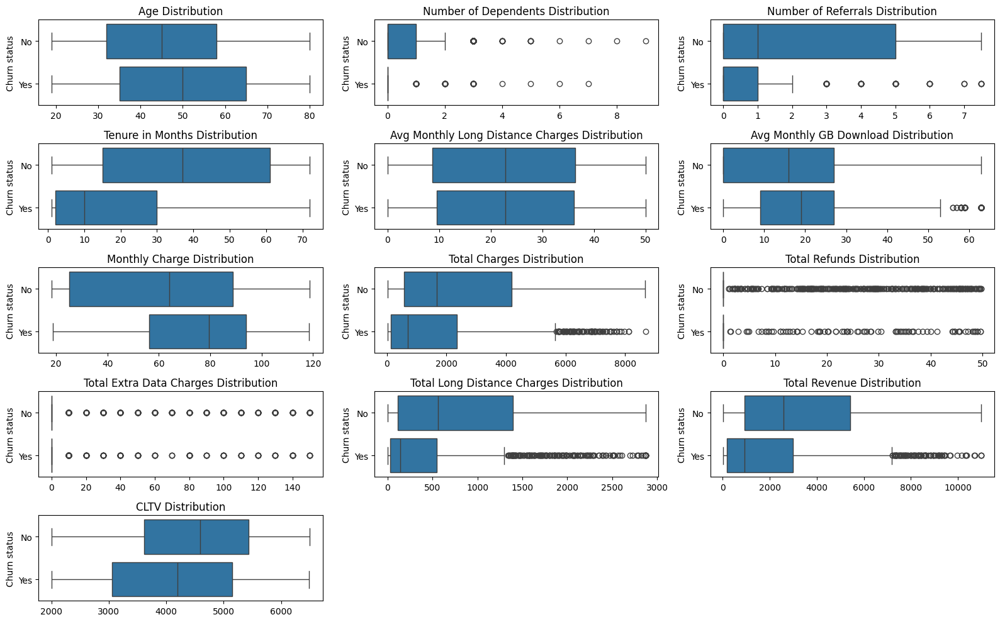

* **Taming long tails.** Eight lopsided characteristics (refunds, extra data charges, dependents, referrals,
  long-distance charges, total charges, monthly download and total revenue) are log-transformed.
* **Balancing.** About 2,600 stayers are removed at random so that leavers and stayers are equally many: **1,495 of
  each (2,990 customers)**. Only the training customers are balanced; the test customers keep the real churn rate.
* **Encoding and scaling.** Each category becomes its own 0/1 column, and numbers are rescaled to a common range.
* **Compressing overlap.** The five overlapping billing and tenure characteristics become **two components** (PCA,
  `Pc_1` and `Pc_2`) that keep **86.7%** of their variation. The trade-off: components are harder to explain to
  business users than "months as a customer".

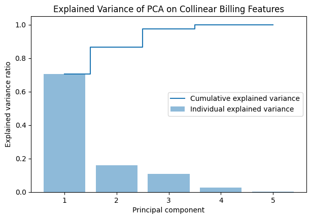

Every learned step is saved, so the app and the serving API prepare new customers exactly the same way.

### 5.4 Phase D: Ready for Modelling

The prepared training customers (2,990, balanced) and test customers (1,409, real churn rate) have **58 model
inputs** each and are saved to `data/processed/`.

---

## 6. Modelling

The notebook prototypes the model in memory. A known source of optimism: the preparation was fitted on all training
customers before cross-validation, so cross-validation scores are slightly optimistic. The test customers are
unaffected, which is why final judgements use Section 7 only.

### 6.1 Candidate Methods

| Candidate | Why it is included |
|---|---|
| Logistic regression | A simple, explainable baseline: if it does as well, boosting is not worth the complexity |
| Gradient Boosting, default settings | What the chosen method achieves without tuning |
| Gradient Boosting, tuned with Optuna | The project's target model |

### 6.2 Training and Testing Tools

Every candidate is scored with the same **5-fold stratified cross-validation** on the balanced training customers:

* **F2**, which weights recall twice as much as precision, matching the recall-first goal. It is the selection and
  tuning target.
* **Recall:** the share of leavers caught.
* **ROC-AUC:** how well the model ranks leavers above stayers, regardless of the cut-off.

Precision is not used here: on balanced data it overstates what the model achieves at the real churn rate.

### 6.3 Starting Point

| Candidate (default settings) | F2 | Recall | ROC-AUC |
|---|---|---|---|
| Logistic regression | 0.843 | 0.852 | 0.906 |
| Gradient Boosting | 0.837 | 0.844 | 0.908 |

### 6.4 Tuning

Optuna proposes new settings near the ones that scored well so far, which usually finds good settings in fewer
attempts than a random search. After **50 attempts**, the best cross-validated F2 is **0.851**. The search is stored
in a log file, so an interrupted run resumes instead of starting over.

### 6.5 Choosing the Model

| Candidate | F2 | Recall | ROC-AUC |
|---|---|---|---|
| **Gradient Boosting, tuned (chosen)** | **0.851** | **0.862** | 0.906 |
| Logistic regression | 0.843 | 0.852 | 0.906 |
| Gradient Boosting, default | 0.837 | 0.844 | 0.908 |

* **Winner:** tuned Gradient Boosting.
* **Close race:** tuning adds only 0.008 F2 over logistic regression, and both rank customers equally well (ROC-AUC
  0.906). The simpler model remains a credible alternative.

### 6.6 From Score to Call Decision

**Correcting the probabilities.** The model learned from a 50/50 mix, but only 26.5% of real customers leave.
Balancing does not change how the model *ranks* customers, but it inflates their probabilities, so each probability
is mapped back to the real churn rate.

**Two cut-offs**, chosen on the training customers so the test stays untouched:

| Cut-off | Value | Leavers caught (training) | Correct calls (training) | Customers called |
|---|---|---|---|---|
| **Recall cut-off** (criterion D3): the most precise one that still catches 85% | **0.268** | 85.2% | 60.8% | 37.1% |
| Break-even cut-off (campaign economics) | 0.164 | 100% | 26.5% | **100%** |

The break-even cut-off flags **every** customer, because no corrected probability falls below it. The probabilities
are squeezed towards the middle, so they need proper calibration before this rule is usable (Section 8.2). Both
cut-offs are saved, so the app applies exactly the same rule.

---

## 7. Evaluation

The chosen model is tested **once** on the 1,409 test customers and compared with two benchmarks. Sections 7.1–7.7
check the model; Sections 7.8–7.10 judge the results against the goals, review the process and decide what happens
next.

### 7.1–7.3 Setup

* **Data:** the 1,409 test customers, with the real churn rate, never used for any choice before.
* **Decision rule:** the recall cut-off; the break-even cut-off is reported for comparison.
* **Benchmarks:** **contact nobody** (recall 0, the floor) and the **month-to-month rule** (contact every
  month-to-month customer), the harder one because contract type is the strongest single signal.

### 7.4 Test Results

| Measure | Model (recall cut-off) | Month-to-month rule |
|---|---|---|
| Recall (leavers caught) | 0.885 | **0.920** |
| Precision (correct calls) | **0.605** | 0.470 |
| F1 | **0.719** | 0.622 |
| F2 | **0.810** | 0.772 |
| Customers called | **38.8%** | 52.0% |
| Lift | **2.28** | 1.77 |
| Campaign net value (illustrative) | **342,430** | 317,765 |
| PR-AUC / ROC-AUC | 0.769 / 0.915 | — |

* **Almost the same leavers with a quarter fewer calls.** The model catches 88.5% of leavers (the rule 92.0%) while
  calling 38.8% of customers instead of 52.0%.
* **Calls are better spent.** Flagged customers leave 2.3 times as often as the average customer, and the expected
  campaign value is **7.8% higher**.
* **Targets:** recall of 0.85 or more: **met**; precision and F1 above the rule: **met**; positive campaign value:
  **met**.
* **The break-even cut-off is not usable yet:** it calls 100% of customers (precision 0.265).

### 7.5 Confusion Matrix and Precision-Recall Curve

* At the recall cut-off the model catches **331 of 374 leavers** and misses 43. It also flags 216 customers who would
  have stayed.
* Across all cut-offs, precision stays far above random calling (average precision 0.77 against 0.27).

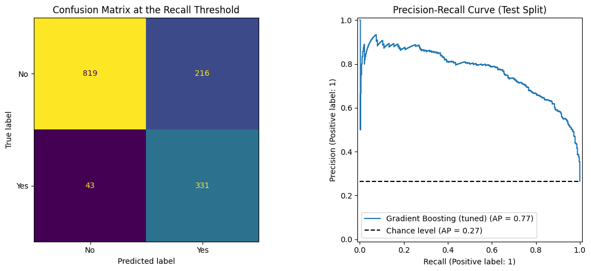

### 7.6 Looking at the Errors

Missed leavers are the costliest error, so they are broken down by contract:

| Contract | Leavers | Missed | Miss rate |
|---|---|---|---|
| Month-to-month | 344 | 23 | 6.7% |
| One year | 24 | 14 | 58.3% |
| Two years | 6 | 6 | 100% |

**The model largely refines the month-to-month signal.** Leavers on longer contracts are mostly missed; signs of
dissatisfaction before contract end would help.

### 7.7 What the Model Relies On

This is measured by **permutation importance**: scramble one input and see how much the ranking quality (PR-AUC) drops.

* **Top inputs:** month-to-month contract, **number of referrals**, two-year contract, and the billing/tenure
  component `Pc_2`. The importance of referrals supports keeping them as features.
* **Everything else matters far less:** household, payment and service inputs follow well behind.

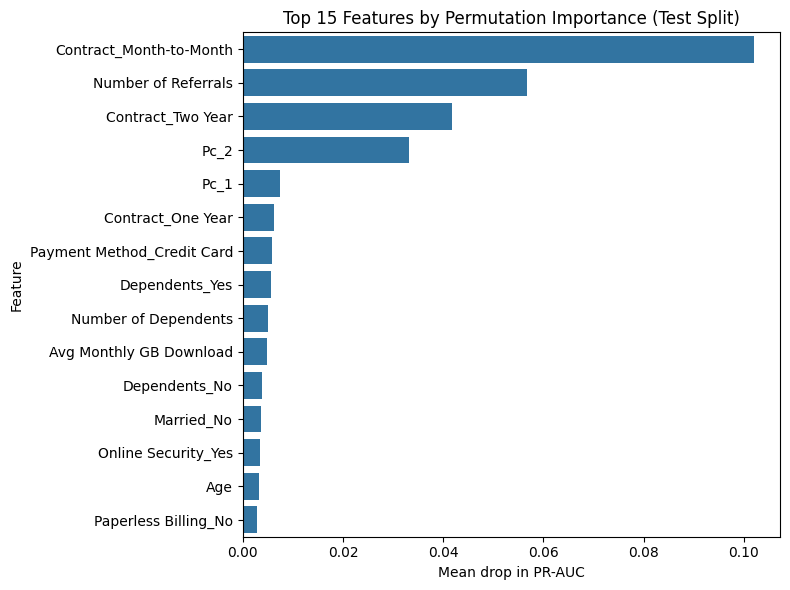

### 7.8 Did It Meet the Success Criteria?

| ID | Criterion | Evidence | Status |
|---|---|---|---|
| B1 | A consolidated view of churn | Overall and per-group churn rates | Achieved |
| B2 | Targeted retention | Ranking of drivers, model importance, recommendations with owners | Achieved |
| B3 | Proactive retention | Net value 342,430 at the recall cut-off; pilot not yet run | **Partly achieved** (pilot pending) |
| D1 | Churn baseline | Churn rate and per-category rates | Achieved |
| D2 | Ranking of drivers | Chi-square screening and permutation importance | Achieved |
| D3 | Recall ≥ 0.85 | Test recall 0.885 | Achieved |
| D4 | Beat the month-to-month rule | Precision 0.605 vs 0.470; F1 0.719 vs 0.622 | Achieved |
| D5 | Validity | Leakage safeguards; test customers used once | Achieved |

**Seven of eight criteria are met.** The open one needs a real pilot, which no offline test can replace.

### 7.9 Reviewing the Process

**What worked**

* The safeguards against leakage held throughout, and the test customers were used once.
* Success criteria, including a business-rule benchmark, were fixed before modelling.
* The cut-offs are saved with the preparation steps, so the app repeats the exact decision rule.

**What to improve next time**

* **Cross-validation optimism:** wrap preparation and model in one pipeline.
* **Balancing:** compare removing stayers with weighting the classes, which keeps all data.
* **Satisfaction score:** confirm when it is collected.
* **Campaign economics:** replace the illustrative costs with real ones.
* **Calibration:** the break-even cut-off flags everyone, so calibrate the probabilities (done in Section 8.2).
* **Long-contract leavers:** add signals of dissatisfaction before contract end.

### 7.10 Decision

| Outcome | Decision |
|---|---|
| D3 and D4 met, campaign value positive | **Approve for the tracked training run and a pilot with a random control group** |
| D3 met, D4 missed | Do not adopt; use the month-to-month rule and return to preparation |
| D3 missed | Revisit the cut-off, balancing and features, and retrain |

**Decision: approve the model for the tracked training run and a controlled pilot** (the first row).

---

## 8. Deployment

### 8.1 Exported Artifacts

The notebook exports everything the later steps need: the prepared training and test customers
(`data/processed/`), every preparation step (`artifacts/preprocessing/`), and the prototype decision rule with the
campaign economics (`artifacts/prototype/decision_policy.json`).

### 8.2 From Prototype to Tracked Training

`pipelines/train.py` repeats Sections 6–7 as a reproducible run tracked with **MLflow** on DagsHub (or locally), with
one important addition: **calibration**. Instead of a formula, the scores are mapped to observed churn frequencies
(isotonic regression on out-of-fold predictions, with stayers re-weighted to the real churn rate). This makes the
break-even cut-off meaningful.

| Measure (test customers) | Tracked model, recall cut-off (0.314) | Tracked model, break-even cut-off (0.164) | Month-to-month rule |
|---|---|---|---|
| Recall | 0.890 | 0.944 | 0.920 |
| Precision | 0.590 | 0.517 | 0.470 |
| F1 | 0.710 | 0.668 | 0.622 |
| Customers called | 40.0% | 48.5% | 52.0% |
| Campaign net value | 341,307 | 341,964 | 317,765 |

* **The same conclusion, now with usable probabilities.** At the recall cut-off the tracked model catches 89.0% of
  leavers with 40.0% of customers called (ROC-AUC 0.910, Brier score 0.105).
* **The break-even rule works after calibration:** it calls 48.5% of customers instead of everyone.
* **Each run logs two models:** the classifier, and `churn_policy_model`, which bundles the classifier, the calibrator
  and both cut-offs. It returns a calibrated chance of leaving, a call flag and a risk level (High / Medium / Low).

### 8.3 Serving and Monitoring

* **Model server:** `mlflow models serve` (or a Docker image built in CI) serves `churn_policy_model`, so the API
  answers exactly what the app shows.
* **Exporter:** a FastAPI proxy in front of the model server exposes **Prometheus** metrics: requests by status,
  latency, payload size and errors, predicted risk levels and probabilities, input values, system load, and true and
  false positives from a feedback endpoint.
* **Inference client:** sends real test customers to the exporter and reports the true outcome back, so recall and
  precision can be tracked live.

### 8.4 The Early-Warning App

The Streamlit app is the retention team's front end. It applies the saved preparation steps, the calibrator and
the cut-offs in the same order as the notebook, and speaks plain language throughout: a risk level, the top three
reasons and a suggested next step instead of probabilities and statistics.

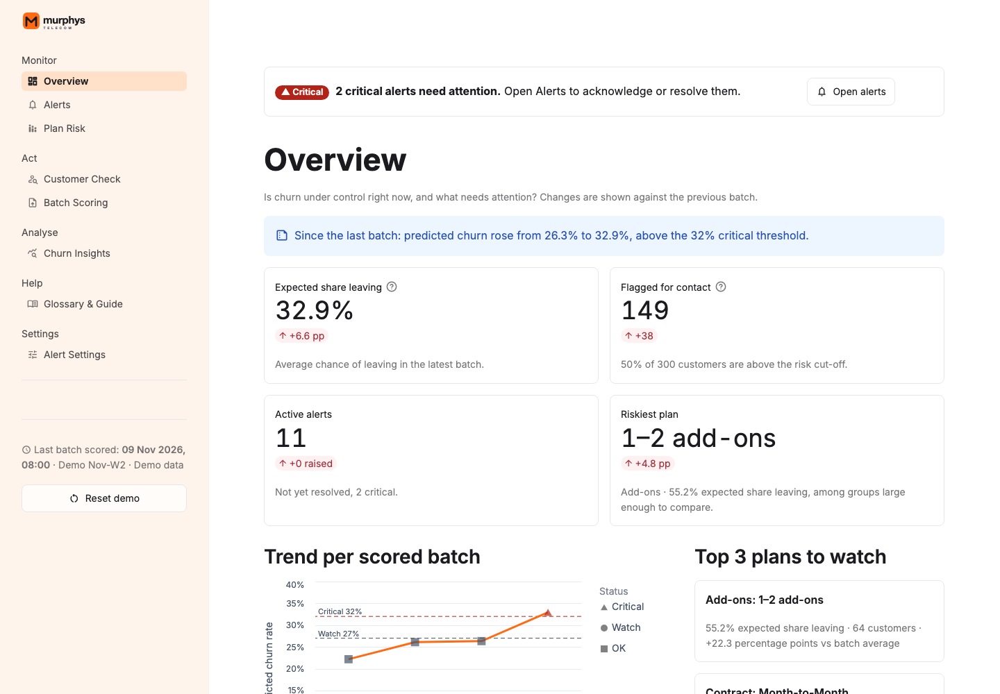

---

## 9. Conclusion and Recommendations

### 9.1 Conclusion

**In one sentence:** one in four customers left in a single quarter, and most share a recognisable profile (a
month-to-month contract, a short tenure, and a fiber connection without protective add-ons), which makes churn
predictable enough to act on early.

* **Churn baseline (Goal 1).** 26.5% of customers left in the quarter, far above the 0.89–0.94% monthly churn of the
  largest U.S. carriers, because the data is a synthetic stress scenario.
* **Drivers (Goal 2).** Contract type is the strongest signal (45.8% against 2.6%), followed by tenure, internet type,
  protective add-ons, payment method and offer. These are links; causal effects need controlled tests.
* **Early-warning model (Goal 3).** Tuned Gradient Boosting was chosen on cross-validation (F2 0.851) and tested once
  on 1,409 customers. It reaches almost the same leavers as the simple rule with a quarter fewer calls, flagged
  customers leave 2.3 times as often as average, and the expected campaign value is 7.8% higher. The tracked,
  calibrated version confirms this (recall 0.890, 40.0% called).

Three caveats temper the result:

* **Tuning adds little:** logistic regression ranks customers just as well (ROC-AUC 0.906).
* **Leavers on long contracts are mostly missed:** 14 of 24 on one-year and all 6 on two-year contracts.
* **Real impact is not proven yet:** a pilot with a random control group is required.

### 9.2 Were the Problems Addressed?

1. **A consolidated picture of churn: addressed** [B1, D1]. The overall rate and the rate of every customer group are
   reported, and the app's Churn Insights page shows them to business users.
2. **Measured drivers: addressed** [B2, D2]. Group comparisons, statistical screening and model importance rank the
   characteristics linked to churn.
3. **An individual early warning: addressed by the model, pilot pending** [B3, D3–D5]. Every customer gets a risk
   level, reasons and a next step from a saved decision rule; proof of retention impact needs a pilot.

### 9.3 Were the Goals Achieved?

| Goal | Result | Status |
|---|---|---|
| 1. Churn baseline | 26.5% churn; churn rate for every category of every characteristic | Achieved |
| 2. Key characteristics | Contract, tenure, internet type, add-ons, payment method and offer ranked; model importance | Achieved |
| 3. Early-warning model | Recall 0.885 (target ≥ 0.85); precision 0.605 and F1 0.719 against 0.470 and 0.622; campaign value 342,430 against 317,765; pilot not yet run | D3–D5 achieved; B3 partly achieved |

### 9.4 Did It Make a Difference?

* **From totals to targets.** One churn rate becomes a set of groups anyone can read in minutes, showing where
  retention budgets should go first.
* **Honest numbers.** Removing outcome columns and fitting every step on the training customers prevents the
  over-optimistic results that leakage would produce.
* **Fewer wasted calls.** Compared with calling every month-to-month customer, the model calls a quarter fewer
  customers while more of those called actually leave.
* **A decision rule, not just a score.** The cut-offs and the calibrator travel with the model, so the app, the API and
  the evaluation apply exactly the same rule.

### 9.5 Recommendations

Because the evidence is associational, each action should run as a test with a control group before a full rollout.

1. **Move month-to-month customers to longer contracts.** *Who: marketing and offer management.* Month-to-month
   customers leave at 45.8% against 2.6% on two-year contracts. Test upgrade incentives on the highest-risk ones.
2. **Strengthen the first months.** *Who: the retention team and customer care.* Leavers have a median of about 10
   months as a customer, stayers about 38. A check-in during the first months can catch problems early.
3. **Review the fiber experience and bundle protective add-ons.** *Who: network and product teams.* Fiber customers
   leave at 40.7%, and internet customers without online security leave at 42% against 15% with it.
4. **Review who receives Offer E.** *Who: marketing and offer management.* Its takers leave at 52.9%. Check whether it
   is aimed at already-risky customers or whether its terms encourage leaving.
5. **Test convenient payment options.** *Who: finance.* Mailed-check and bank-withdrawal payers leave at 36.9% and
   34.0% against 14.5% for credit card.
6. **Improve the data behind the model.** *Who: data science, with finance.* Record when satisfaction scores are
   collected, and supply real offer and contact costs.

### 9.6 Limitations and Future Work

* **Synthetic, single-quarter data.** The data describes a fictional company over one quarter; patterns may not
  transfer to a real operator, and a time-based test is not possible.
* **New customers.** The 454 customers who joined during the quarter are counted as staying, although they had little
  time to leave.
* **Excluded satisfaction score.** If it is in fact collected before churn, the model understates what is achievable.
* **Illustrative economics.** The campaign value uses literature-based cost ratios, not the company's own costs.
* **Balancing and compression.** Balancing discards almost half of the training customers, and the two billing
  components are harder to explain than the original characteristics; both should be compared with simpler options.

---

## How to Run

**The quickest way:** start the app on your own computer (below). Nothing needs to be trained: the repository already
includes the files it reads, namely the trained model in `artifacts/model/`, the preparation steps in
`artifacts/preprocessing/`, and the demo data in `app/data/`.

### What you need

* **Python 3.11–3.13** (tested with 3.13)
* **Git**, to download the repository
* **make** (optional; every command below also works without it)

### 1. Download the project

```bash
git clone https://github.com/DcMurphys/telco-customer-churn-prediction.git
cd telco-customer-churn-prediction
```

### 2. Install the dependencies

Create a separate Python environment, so the project does not affect other Python work on your computer:

```bash
make setup                         # creates .venv and installs requirements-dev.txt
```

Without `make`, or to install only what the app needs:

```bash
python3 -m venv .venv
source .venv/bin/activate          # Windows: .venv\Scripts\activate
pip install -r app/requirements.txt
```

### 3. Start the app

```bash
make app                           # or: streamlit run app/streamlit_app.py
```

The app opens at http://localhost:8501. Its pages:

| Page | What it shows |
|---|---|
| **Overview** | The latest batch: expected share leaving, customers to call, alerts, riskiest plan, and the trend |
| **Alerts** | Alerts raised by scored batches, to acknowledge, resolve and export |
| **Plan Risk** | Which contracts, offers, internet types and add-on bundles lose most customers, with what to do |
| **Customer Check** | One customer's risk level, top reasons, suggested offer and talking points |
| **Batch Scoring** | Upload a customer file, fix flagged rows, score it and download the results |
| **Churn Insights** | Who leaves, when, and which add-ons go with staying, with takeaways |
| **Glossary & Guide** | Terms, two-minute guides, risk levels, how reliable the predictions are, and limitations |
| **Alert Settings** | Thresholds for alerts, with a preview and an audit log |

The demo data (four weekly batches and sample files to upload) is reset per visitor with **Reset demo**.

### 4. Run the tests (optional)

The tests check the preparation, input validation, scoring and alerts, the exploratory figures, every app page, and
the serving code.

```bash
make test                          # or: pytest
make lint                          # ruff, as in CI
```

### 5. Train and serve the model (optional)

```bash
make data                          # rebuild app/data/ (needs data/raw/telco.csv from the notebook)
make train                         # tracked training, logged to a local ./mlruns
make train-online                  # the same, logged to DagsHub (MLflow credentials in .env)
```

To serve the model with monitoring, install `requirements-serving.txt` (included in `make setup`) and run each command
in its own terminal:

```bash
make serve-model                   # the latest churn_policy_model on port 5005
make exporter                      # Prometheus exporter on port 8080: /predict, /feedback, /metrics
make client                        # sends 20 test customers and their true outcome
```

`make help` lists every task.

### 6. Deploy (optional)

* **GitHub.** Secrets live in `.env` (ignored); raw data, `mlruns/` and caches are ignored too. On every push and
  pull request, CI runs the linter, the app tests (with the same packages as Streamlit Cloud) and the serving tests.
* **Streamlit Community Cloud.** Create an app from the repository with the main file `app/streamlit_app.py` and
  Python 3.12. Dependencies come from `app/requirements.txt`; no secrets are needed.
* **Training and model image from GitHub Actions.** *Actions → CI → Run workflow* trains on the remote MLflow server,
  smoke-tests the logged model, commits the new `artifacts/model/` (which redeploys the app), and builds, tests and
  pushes the serving image `murphys-telecom-churn-system` to Docker Hub. It needs these repository secrets:

  | Secret | Value |
  |---|---|
  | `MLFLOW_TRACKING_URI` | `https://dagshub.com/dharma.dwicahaya/telco-customer-churn-prediction.mlflow` |
  | `MLFLOW_TRACKING_USERNAME` | DagsHub user name |
  | `MLFLOW_TRACKING_PASSWORD` | DagsHub access token |
  | `DOCKER_HUB_USERNAME`, `DOCKER_HUB_ACCESS_TOKEN` | only when the image is pushed |

### Project layout

| Folder | Contents |
|---|---|
| `notebooks/` | The analysis notebook, the source of every number in this README |
| `data/` | `raw/` (downloaded by the notebook, not committed), `processed/` (prepared training and test customers), `payloads/` (sample API requests, not committed) |
| `artifacts/` | `preprocessing/` (saved preparation steps), `prototype/` (notebook decision rule), `model/` (trained model, calibrator, cut-offs, reports) |
| `src/telco_churn/` | Code shared by training, serving and the app: settings, preparation of new customers, the decision rule, and the MLflow model |
| `pipelines/` | Tracked training (`train.py`) and the app's demo data (`build_app_data.py`) |
| `serving/` | Prometheus exporter, inference client and request helpers |
| `app/` | The Streamlit app (models, controllers and views), its demo data, logo and font |
| `tests/` | Automated tests |
| `assets/readme/` | Images used in this README |
| `.github/workflows/` | CI and the manual training and image workflow |

---

## Glossary

| Term | Meaning |
|---|---|
| **Churn** | A customer ending the service during the period. The *churn rate* is the share of customers in a group who left. |
| **Data leakage** | Giving a model information it would not have when it makes a real prediction, such as the reason a customer left. It makes results look better than they are. |
| **Stratified split** | Dividing customers into training and test sets while keeping the churn rate the same in both. |
| **Chi-square test** | A test of whether a category's share differs between leavers and stayers. A p-value below 0.05 means a link exists; it does not say how strong it is. |
| **Pearson correlation (r)** | How closely two numbers move together in a straight line, from −1 to +1. It does not prove cause and effect. |
| **Capping (winsorization)** | Limiting extreme values to a boundary instead of deleting customers. |
| **Log transformation** | Compressing large values so that a few very high totals do not dominate. |
| **Balancing (undersampling)** | Randomly removing stayers from the training customers so leavers and stayers are equally many. |
| **PCA** | Replacing several overlapping characteristics with a few components that keep most of their variation. |
| **Gradient Boosting** | A machine-learning method that adds small decision trees one by one, each correcting the last. |
| **Cross-validation** | Testing a model several times, each time training on part of the data and testing on the rest. |
| **Recall / precision** | The share of leavers the model flags / the share of flagged customers who actually leave. |
| **F1 / F2** | Balances of precision and recall; F2 weights recall twice as much. |
| **Lift** | How many times more often flagged customers leave than the average customer. |
| **PR-AUC / ROC-AUC** | Measures of how well the model ranks leavers above stayers, across all cut-offs. |
| **Calibration** | Adjusting scores so that a 30% chance of leaving really means about 3 in 10 leave. |
| **Recall cut-off / break-even cut-off** | The chance of leaving above which a customer is called: the most precise cut-off that still catches 85% of leavers / the point where a call pays for itself. |
| **Permutation importance** | How much worse the model gets when one input is scrambled. |
| **MLflow / DagsHub** | Tools that record every training run, its settings, results and model files. |
| **Prometheus** | A monitoring system that collects live metrics from the serving API. |
| **CRISP-DM** | A standard step-by-step method for data projects. |

---

## References

Citations follow APA 7th edition.

### Company, industry and business reports

AT&T. (2025, October 22). *AT&T reports strong third-quarter financial performance* [Press release].
https://about.att.com/story/2025/3q-earnings.html

Gallo, A. (2014, October 29). The value of keeping the right customers. *Harvard Business Review*.
https://hbr.org/2014/10/the-value-of-keeping-the-right-customers

IBM. (2019, July 11). *Telco customer churn (11.1.3+)* [Sample data module, IBM Cognos Analytics]. IBM Community.
https://community.ibm.com/community/user/businessanalytics/blogs/steven-macko/2019/07/11/telco-customer-churn-1113

J.D. Power. (2025a, January 30). *Wireless product complexities and evolving customer expectations lead to drop in
customer care satisfaction, J.D. Power finds* [Press release]. Business Wire.
https://www.businesswire.com/news/home/20250130315505/en/

J.D. Power. (2025b, July 31). *J.D. Power: New wireless carrier benchmark study highlights importance of strong value
proposition* [Press release]. Business Wire. https://www.businesswire.com/news/home/20250731579376/en/

T-Mobile US. (2025, October 23). *T-Mobile delivers record customer growth, fueled by widening differentiation and
focus on durable and profitable financial growth, raises guidance across the board* [Press release].
https://www.t-mobile.com/news/business/t-mobile-q3-2025-earnings

Verizon. (2025, October 29). *Verizon reports 3Q 2025 earnings; reiterates full-year financial guidance* [Press
release].
https://www.verizon.com/about/news/verizon-reports-3q-2025-earnings-reiterates-full-year-financial-guidance

Verizon. (2026, October 26). *[Third-quarter 2026 earnings press release]*.
https://www.verizon.com/about/news/verizon-delivers-another-record-breaking-quarter

### Scientific papers

Akiba, T., Sano, S., Yanase, T., Ohta, T., & Koyama, M. (2019). Optuna: A next-generation hyperparameter optimization
framework. In *Proceedings of the 25th ACM SIGKDD International Conference on Knowledge Discovery & Data Mining*
(pp. 2623–2631). ACM. https://doi.org/10.1145/3292500.3330701

Ascarza, E. (2018). Retention futility: Targeting high-risk customers might be ineffective. *Journal of Marketing
Research, 55*(1), 80–98. https://doi.org/10.1509/jmr.16.0163

Dal Pozzolo, A., Caelen, O., Johnson, R. A., & Bontempi, G. (2015). Calibrating probability with undersampling for
unbalanced classification. In *2015 IEEE Symposium Series on Computational Intelligence* (pp. 159–166). IEEE.
https://doi.org/10.1109/SSCI.2015.33

de Haan, E., Verhoef, P. C., & Wiesel, T. (2015). The predictive ability of different customer feedback metrics for
retention. *International Journal of Research in Marketing, 32*(2), 195–206.
https://doi.org/10.1016/j.ijresmar.2015.02.004

Garnefeld, I., Eggert, A., Helm, S. V., & Tax, S. S. (2013). Growing existing customers' revenue streams through
customer referral programs. *Journal of Marketing, 77*(4), 17–32. https://doi.org/10.1509/jm.11.0423

Gustafsson, A., Johnson, M. D., & Roos, I. (2005). The effects of customer satisfaction, relationship commitment
dimensions, and triggers on customer retention. *Journal of Marketing, 69*(4), 210–218.
https://doi.org/10.1509/jmkg.2005.69.4.210

Kaufman, S., Rosset, S., Perlich, C., & Stitelman, O. (2012). Leakage in data mining: Formulation, detection, and
avoidance. *ACM Transactions on Knowledge Discovery from Data, 6*(4), 1–21. https://doi.org/10.1145/2382577.2382579

Lemmens, A., & Gupta, S. (2020). Managing churn to maximize profits. *Marketing Science, 39*(5), 956–973.
https://doi.org/10.1287/mksc.2020.1229

Manzoor, A., Qureshi, M. A., Kidney, E., & Longo, L. (2024). A review on machine learning methods for customer churn
prediction and recommendations for business practitioners. *IEEE Access, 12*, 70434–70463.
https://doi.org/10.1109/ACCESS.2024.3402092

Ribeiro, H., Barbosa, B., Moreira, A. C., & Rodrigues, R. G. (2024). Determinants of churn in telecommunication
services: A systematic literature review. *Management Review Quarterly, 74*(3), 1327–1364.
https://doi.org/10.1007/s11301-023-00335-7

Schmitt, P., Skiera, B., & Van den Bulte, C. (2011). Referral programs and customer value. *Journal of Marketing,
75*(1), 46–59. https://doi.org/10.1509/jm.75.1.46

Verbraken, T., Verbeke, W., & Baesens, B. (2013). A novel profit maximizing metric for measuring classification
performance of customer churn prediction models. *IEEE Transactions on Knowledge and Data Engineering, 25*(5),
961–973. https://doi.org/10.1109/TKDE.2012.50

### Data sets and software

Bravo, C., vanden Broucke, S., & Verbraken, T. (2017). *EMP: Expected maximum profit classification performance
measure* (Version 2.0.2) [Computer software]. CRAN. https://cran.r-project.org/package=EMP

Terry, A. F. (n.d.). *Telco customer churn (11.1.3+)* [Data set]. Kaggle.
https://www.kaggle.com/datasets/alfathterry/telco-customer-churn-11-1-3

---

## License

The code in this repository is released under the [MIT License](LICENSE), © 2026 Dwi Cahaya Dharma.

The licence does not cover material owned by others:

* **Data:** the Telco Customer Churn (11.1.3+) sample was created by IBM as fictional sample data for IBM Cognos
  Analytics. IBM's page does not state a licence for it, so it is used here for education and demonstration only.
  The Kaggle republication that the notebook downloads is listed under the MIT License by its uploader. The derived
  extracts in `app/data/` and `data/processed/` come from that sample and are not covered by this repository's
  licence.
* **Font:** Inter in `app/static/fonts/` is licensed under the SIL Open Font License 1.1 (see `Inter-LICENSE.txt`).
